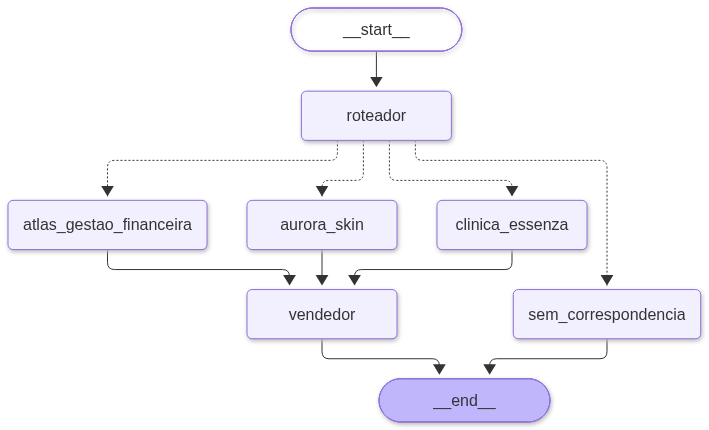
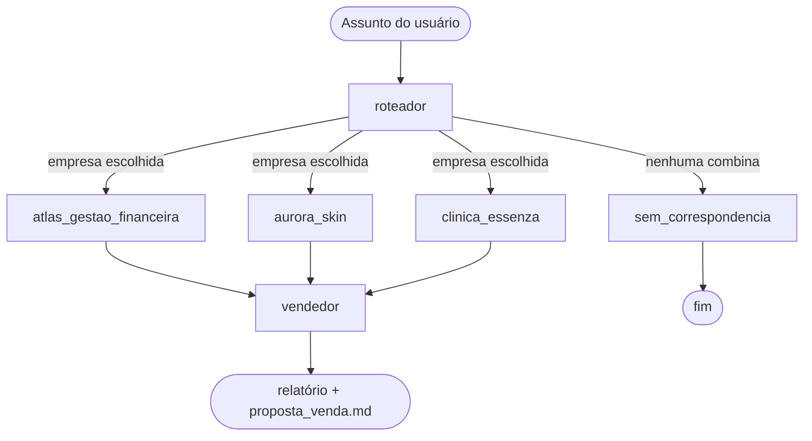

# IdeiaFlui — Orquestrador Multiagente (LangGraph + CrewAI)

Sistema multiagente em Python que **simula a operação de três empresas fictícias, identifica onde cada uma perde tempo com trabalho manual e transforma esses gargalos em uma proposta comercial**.

Um fluxo LangGraph recebe um assunto, escolhe a empresa mais adequada, aciona a equipe de agentes CrewAI dessa empresa e entrega o relatório gerencial produzido a um agente vendedor, que redige a proposta.



---

## Intenção do projeto

Este é um **projeto pessoal de estudo**, criado para praticar Python e a orquestração de sistemas multiagente, e publicado no GitHub como peça de portfólio.

A ideia central é mostrar, de forma prática, como a **demanda por automação aparece naturalmente na rotina de uma empresa**:

1. cada empresa fictícia opera **sem nenhuma automação ou serviço da IdeiaFlui**, de forma manual, com seus setores representados por agentes;
2. ao descrever a própria rotina, os agentes expõem tarefas repetitivas, propensas a erro e o tempo que consomem;
3. a partir desse diagnóstico, um agente comercial propõe soluções do catálogo da IdeiaFlui.

> **Importante:** o projeto é independente da operação da IdeiaFlui. Ele não executa, automatiza nem entrega nenhum dos serviços da empresa. O catálogo de serviços é usado apenas como base para a proposta simulada. As empresas, os dados e os números são fictícios.

---

## Objetivo

- **Praticar** Python, LangGraph e CrewAI em um projeto completo, com configuração, testes e documentação.
- **Demonstrar** uma arquitetura em que um grafo de estados orquestra equipes de agentes independentes.
- **Gerar evidência de demanda**: cada execução produz um relatório com os gargalos operacionais da empresa e uma proposta que os relaciona a serviços reais do catálogo.
- **Manter a separação de papéis**: as equipes das empresas nunca mencionam a IdeiaFlui. Só o agente vendedor conhece o catálogo.

---

## Como funciona



1. **Entrada.** O usuário informa um assunto (por exemplo, `ecommerce`), pela linha de comando ou de forma interativa.
2. **Roteador.** Um LLM com saída estruturada (Pydantic) compara o assunto com o perfil de cada empresa (segmento, público, pilares de conteúdo e setores, lidos dos `empresa.yaml`). Ele escolhe a mais próxima e escreve um **briefing** curto para a semana de trabalho dela. Se nenhuma combinar, o fluxo termina no nó `sem_correspondencia`.
3. **Equipe da empresa.** A crew CrewAI da empresa escolhida recebe o briefing e executa suas tarefas em sequência. Os setores produzem seus planos e o gerente geral consolida tudo em um **relatório gerencial** que termina com a seção *Gargalos Operacionais*, com horas simuladas perdidas por semana.
4. **Vendedor.** O agente comercial da IdeiaFlui lê o relatório, cruza os problemas com o catálogo (`config/ideiaflui/servicos.yaml`) e redige a **proposta comercial** em Markdown, salva ao lado do relatório.

### Estado compartilhado do grafo

| Campo | Conteúdo |
| :-- | :-- |
| `assunto` | Tema informado pelo usuário |
| `empresa` | Id da empresa escolhida pelo roteador, ou `nenhuma` |
| `briefing` | Contexto operacional gerado para a equipe |
| `justificativa` | Motivo da escolha da empresa |
| `resultado` | Saída bruta da equipe |
| `arquivo` | Caminho do relatório gerencial |
| `proposta` | Texto da proposta comercial |
| `arquivo_proposta` | Caminho da proposta salva |

---

## As empresas fictícias

| Empresa | Segmento | Agentes | Tarefas |
| :-- | :-- | :-- | :-- |
| **Atlas Gestão Financeira** | B2B: BPO financeiro, controladoria e processos para PMEs | financeiro, fiscal, comercial, gerente geral | `painel_financeiro`, `rotina_fiscal`, `plano_comercial`, `relatorio_gerencial_atlas` |
| **Aurora Skin** | B2C: skincare botânico e e-commerce | marketing, e-commerce, produto, gerente geral | `plano_marketing`, `plano_ecommerce`, `validacao_produto`, `relatorio_gerencial_aurora` |
| **Clínica Essenza** | B2C: dermatologia, cosmiatria e estética médica | marketing, agendamento, gestor operacional, gerente geral (compliance) | `plano_conteudo`, `plano_atendimento`, `painel_operacional`, `relatorio_gerencial_essenza` |

Cada empresa é descrita por três arquivos YAML em `config/empresas/<empresa>/`:

- **`empresa.yaml`**: perfil, voz e tom, restrições (regulatórias, de conteúdo e do projeto), setores, fontes de dados, KPIs de referência e briefings.
- **`agents.yaml`**: papel, objetivo e histórico de cada agente.
- **`tasks.yaml`**: descrição, saída esperada, agente responsável, contexto entre tarefas e arquivo de saída.

Adicionar uma nova empresa significa criar essa pasta, a classe da equipe em `src/equipes/` e uma entrada no registro `REGISTRO_EQUIPES`.

---

## Meios utilizados

| Camada | Tecnologia |
| :-- | :-- |
| Linguagem | Python >=3.11,<3.14 (3.11 como versão de referência) |
| Orquestração do fluxo | [LangGraph](https://github.com/langchain-ai/langgraph) (`StateGraph`, arestas condicionais) |
| Equipes de agentes | [CrewAI](https://github.com/crewAIInc/crewAI) (`@CrewBase`, processo sequencial, configuração em YAML) |
| LLM do roteador e do vendedor | Google Gemini via `langchain-google-genai`, com saída estruturada |
| LLM das equipes | Google Gemini via `crewai.LLM` |
| Validação de dados | Pydantic |
| Configuração | YAML (`pyyaml`) e variáveis de ambiente (`python-dotenv`) |
| Testes | pytest |
| Saídas | Relatórios e propostas em Markdown; diagrama do grafo em PNG |

Os modelos usados em cada ponto estão definidos nos próprios módulos (`src/fluxo/roteador.py`, `src/fluxo/vendedor.py` e `src/equipes/*.py`) e podem ser trocados.

### Decisões de projeto

- **Configuração em YAML.** O perfil das empresas e o catálogo de serviços ficam fora do código. O roteador monta o prompt a partir dos `empresa.yaml`, então não há descrições duplicadas.
- **Equipes independentes.** Cada crew roda sozinha (`python -m src.equipes.atlas_gestao`) e só depois é conectada ao grafo, o que facilita testar e depurar.
- **Nós gerados por fábrica.** `criar_no_equipe(id_empresa)` cria um nó do grafo para cada empresa registrada. A aresta condicional usa o mesmo registro.
- **Relatório em arquivo como contrato.** A equipe grava o relatório em `relatorios/<empresa>/relatorio_gerencial.md`, e o vendedor lê esse arquivo. Os dois módulos se comunicam por um caminho no estado, e não por texto solto.
- **Separação de papéis.** As restrições do projeto proíbem as equipes de sugerir automação ou citar a IdeiaFlui. O vendedor é o único com acesso ao catálogo e só pode oferecer o que está nele.
- **Catálogo completo no prompt.** O `servicos.yaml` reúne serviços, pacotes de escopo fechado (com entregas, prazo, investimento, itens fora do escopo e premissas), metodologia, condições comerciais e contatos. O vendedor recebe o arquivo inteiro e usa só o que está nele.
- **Proposta em texto livre.** O vendedor gera o Markdown diretamente a partir de um prompt com regras e formato definidos, sem etapa de pós-processamento. Isso mantém o nó simples, e o resultado pode variar entre execuções.
- **Respostas curtas de propósito.** As equipes usam um limite baixo de `max_tokens`, para economizar consumo, acelerar os testes e obter relatos mais naturais, mais próximos da fala de um funcionário descrevendo as próprias dificuldades. Para relatórios mais longos, aumente o limite em `src/equipes/*.py`.
- **Regras comerciais no vendedor.** Ele não inventa serviços, preços, prazos ou garantias, não promete resultados e não vende serviços que a IdeiaFlui não oferece (BPO, controladoria e execução fiscal).

---

## Estrutura do projeto

```
ideiaflui/
├── main.py                      # ponto de entrada (CLI e modo interativo)
├── pyproject.toml
├── requirements.txt
├── .env.example                 # modelo das variáveis de ambiente
├── config/
│   ├── ideiaflui/
│   │   └── servicos.yaml        # catálogo: serviços, pacotes, metodologia e condições
│   └── empresas/
│       ├── atlas_gestao/        # empresa.yaml, agents.yaml, tasks.yaml
│       ├── aurora_skin/
│       └── clinica_essenza/
├── src/
│   ├── fluxo/                   # orquestração (LangGraph)
│   │   ├── estado.py            # EstadoFluxo
│   │   ├── roteador.py          # escolha da empresa + briefing
│   │   ├── equipes.py           # registro das crews e fábrica de nós
│   │   ├── grafo.py             # montagem e compilação do grafo
│   │   └── vendedor.py          # proposta comercial
│   ├── equipes/                 # crews CrewAI de cada empresa
│   │   ├── atlas_gestao.py
│   │   ├── aurora_skin.py
│   │   └── clinica_essenza.py
│   ├── flow/ e crews/           # aliases de compatibilidade
├── tests/
│   └── test_fluxo.py
├── relatorios/<empresa>/        # relatórios e propostas gerados (exemplos)
└── outputs/
    └── grafo.png                # diagrama do fluxo
```

O `id` dentro de cada `empresa.yaml` é a chave usada pelo registro e pelo grafo. O nome da pasta pode ser diferente (por exemplo, a pasta `atlas_gestao` contém a empresa `atlas_gestao_financeira`).

---

## Como executar

### 1. Instalação

```bash
git clone <url-do-repositorio>
cd ideiaflui

python -m venv .venv
source .venv/bin/activate        # Windows: .venv\Scripts\activate

pip install -r requirements.txt
# ou, para instalar também as dependências de desenvolvimento:
pip install -e ".[dev]"
```

### 2. Configuração

Copie o modelo e preencha com a sua chave da API do Google Gemini:

```bash
cp .env.example .env
```

| Variável | Uso |
| :-- | :-- |
| `GEMINI_API_KEY` / `GOOGLE_API_KEY` | Roteador, vendedor e agentes das equipes (obrigatória) |
| `CREWAI_TRACING_ENABLED` | Telemetria do CrewAI (`false` por padrão) |

O arquivo `.env` está no `.gitignore` e não deve ser versionado.

### 3. Execução

A partir da raiz do projeto:

```bash
# informando o assunto por argumento
python main.py --assunto "ecommerce"

# ou em modo interativo
python main.py
```

Exemplo ilustrativo: para o assunto `ecommerce`, o roteador tende a escolher a **Aurora Skin** e gerar um briefing como *"Planejar a semana de lançamento do Kit Ritual Serenidade, com ações de conteúdo, vendas e explicação dos produtos"*, que é enviado à equipe da marca.

Ao final, os arquivos ficam em `relatorios/<empresa>/`:

- arquivos de cada tarefa (por exemplo, `rotina_fiscal.md`, `plano_comercial.md`);
- `relatorio_gerencial.md`, com a consolidação e os gargalos operacionais;
- `proposta_venda.md`, com a proposta comercial da IdeiaFlui.

O diagrama do grafo (`outputs/grafo.png`) não é regenerado a cada execução, porque `construir_grafo(salvar_imagem=False)` é o padrão. Para atualizá-lo, chame `construir_grafo(salvar_imagem=True)`. A geração usa um serviço online e precisa de internet.

Cada equipe também pode ser executada isoladamente:

```bash
python -m src.equipes.atlas_gestao
python -m src.equipes.aurora_skin
python -m src.equipes.clinica_essenza
```

### 4. Testes

```bash
pytest
```

Os testes validam o carregamento das empresas, o registro das equipes, a decisão do roteamento condicional, o nó `sem_correspondencia` e a compilação do grafo. Eles não chamam o LLM.

---

## Limitações

- Cada execução completa realiza 6 chamadas consecutivas ao LLM (1 do roteador, 4 das tarefas da equipe CrewAI e 1 do vendedor). No plano gratuito do Google Gemini, a cota diária de requisições permitiu cerca de 3 execuções por dia durante os testes práticos (atingindo o erro de Rate Limit HTTP 429 / Resource Exhausted). O limite efetivo depende do modelo e do plano da conta.
- Os dados, números, horas perdidas e indicadores são **simulados** pelos agentes e não representam empresas reais.
- Os resultados variam de uma execução para outra, por depender de modelos de linguagem. Relatórios e propostas devem ser revisados antes de qualquer uso fora de demonstração.
- Os relatórios das equipes são propositalmente enxutos, por causa do limite de tokens. Os detalhes de cada setor podem aparecer resumidos.
- A execução depende de uma chave de API e gera custo de uso dos modelos.
- Em setores regulados (como a Clínica Essenza, sujeita às regras de publicidade médica), o conteúdo gerado é ilustrativo e não substitui revisão profissional.

---

## Autor

Eduardo Petrocchi
